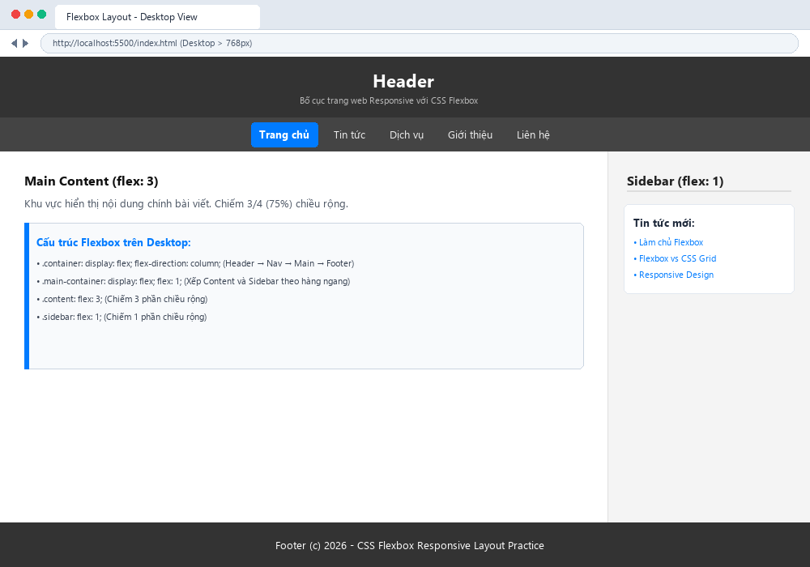
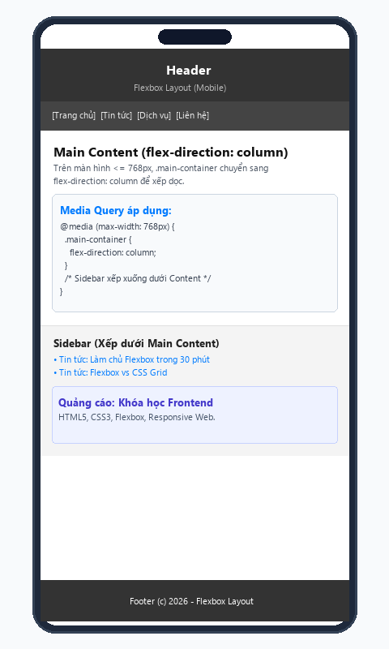
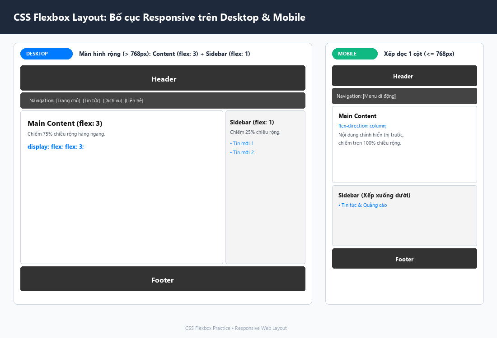

# [Thực hành] Xây dựng bố cục trang web với CSS Flexbox

Bài thực hành luyện tập sử dụng **CSS Flexbox** để xây dựng một bố cục trang web hoàn chỉnh, có khả năng thích ứng (responsive) linh hoạt trên cả **Desktop** và **Mobile**.

---

## 📋 1. Mô tả bài tập

Bố cục trang web bao gồm các phần chính:
- **Header:** Hiển thị tiêu đề trang (`background-color: #333`).
- **Navigation:** Menu điều hướng các chuyên mục (`background-color: #444`).
- **Main Container:** Vùng chứa chia tỷ lệ giữa Content và Sidebar (`display: flex; flex: 1;`).
  - **Main Content:** Khu vực nội dung bài viết chính (`flex: 3;` chiếm 75% chiều rộng).
  - **Sidebar:** Khu vực nội dung phụ gồm tin tức và quảng cáo (`flex: 1;` chiếm 25% chiều rộng).
- **Footer:** Hiển thị thông tin chân trang (`background-color: #333`).

---

## 📐 2. Phân tích nguyên lý CSS Flexbox & Responsive

### Bố cục trên Desktop (> 768px):
```css
.container {
    display: flex;
    flex-direction: column;
    min-height: 100vh;
}

.main-container {
    display: flex;
    flex: 1;
}

.content {
    flex: 3;
}

.sidebar {
    flex: 1;
}
```
- `.container` xếp theo cột dọc (`flex-direction: column`), các phần tử con sắp xếp tuần tự: Header &rarr; Nav &rarr; Main Container &rarr; Footer.
- `.main-container` xếp theo hàng ngang (`flex-direction: row` mặc định), phân chia diện tích theo tỷ lệ `flex: 3` và `flex: 1` (3 : 1).

### Bố cục trên Mobile (≤ 768px):
```css
@media (max-width: 768px) {
    .main-container {
        flex-direction: column;
    }
}
```
- Khi màn hình nhỏ hơn hoặc bằng 768px, `.main-container` chuyển hướng trục chính sang `flex-direction: column`.
- Sidebar tự động chuyển xuống nằm phía dưới Content, giúp nội dung chính hiển thị trọn vẹn và không bị ép ngang.

---

## 📸 3. Ảnh chụp kết quả trên trình duyệt

### 1. Giao diện Desktop (> 768px):


### 2. Giao diện Mobile (≤ 768px):


### 3. Tổng hợp so sánh Desktop & Mobile:


---

## 📁 4. Cấu trúc thư mục dự án

```text
css-flexbox-layout/
├── index.html                  # Mã nguồn HTML (Header, Nav, Main Container, Footer)
├── style.css                   # Định kiểu CSS Flexbox & Media Query Responsive
├── screenshot_desktop.png      # Ảnh chụp giao diện Desktop
├── screenshot_mobile.png       # Ảnh chụp giao diện Mobile
├── tat_ca_giao_dien.png        # Ảnh chụp tổng quan so sánh
└── README.md                   # Tài liệu thuyết minh chi tiết
```

---

## 🚀 5. Hướng dẫn kiểm tra trên trình duyệt
1. Mở file `index.html` bằng trình duyệt web bất kỳ.
2. Nhấn `F12` để mở công cụ Developer Tools, bật chế độ **Device Emulation** (`Ctrl + Shift + M`).
3. Kéo thay đổi độ rộng màn hình qua ngưỡng `768px` để quan sát sự chuyển đổi linh hoạt của Sidebar từ dạng cột bên cạnh sang xếp xuống dưới Content.
